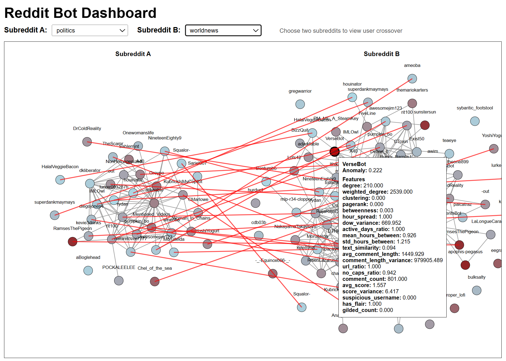
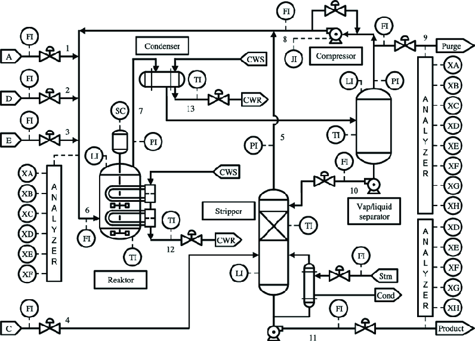

# Data Science & Machine Learning Portfolio

M.S. Analytics graduate from the Georgia Institute of Technology with a background in mathematics, statistics, and engineering. My projects focus on machine learning, anomaly detection, graph analysis, and industrial time-series systems, with experience developing deep learning and unsupervised methods for academic research and industry-sponsored projects.

## Projects

### Emotion-Aware Art Caption Generation

  

    

      Explored deep learning approaches to artwork caption
      generation using a ResNet-50 image encoder with LSTM
      and Transformer decoders. Investigated methods for
      capturing visual content and subjective emotional
      interpretation.
    

    <a href="projects/art-image-captioning.html">View Project Page</a>

  

  <figure style="width: 220px; max-width: 100%; margin: 0;">

    

    <figcaption style="font-size: 13px; text-align: center; margin-top: 6px;">
      <strong>Generated caption:</strong>
      The woman's face is very calm and serene.
    </figcaption>

  </figure>

### Reddit Bot Detection

  

    

      Unsupervised anomaly detection on large-scale Reddit interaction
      graphs using feature engineering, graph embeddings, and anomaly
      detection. Built an interactive D3.js visualization for exploring
      anomalous user behavior and network structure.
    

    <a href="projects/reddit-bot-detection.html">View Project Page</a>

  

  

### Industrial Equipment Degradation Detection

  

    

      Industry-sponsored research project investigating unsupervised deep learning methods for fault detection in industrial multivariate time-series systems. Developed and evaluated models for detecting rare failures and handling operational drift across simulated and real-world datasets.
    

    <a href="projects/projects/industrial-degradation.html">View Project Page</a>

  

  

